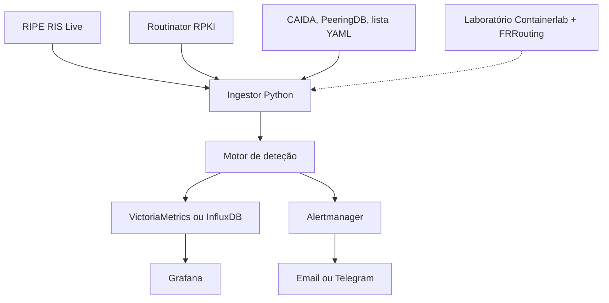

# Monitor de segurança BGP: design doc

Autor: Ussumane Embaló · Outubro de 2026

## Contexto e utilizadores

O BGP confia nos anúncios das outras redes, por isso um hijack ou um route leak pode desviar tráfego sem aviso. Este sistema vigia anúncios BGP públicos de ASes portugueses e alerta cedo, sem tomar nenhuma ação sobre as rotas.

Os utilizadores são os donos de AS (operadores e IXP). Estão ocupados, não conhecem o sistema e podem ler o alerta no telemóvel às 3 da manhã. Cada alerta tem de responder a seis perguntas:

- O quê: o tipo de ataque (hijack de origem, sub-prefixo, vizinho novo, route leak).
- Quem e onde: o prefixo afetado e o AS suspeito.
- Prova: o AS path que despoletou o alerta.
- Gravidade: a severidade e a confiança, com o motivo do nível.
- Quando: a hora da primeira deteção e se continua ativo.
- O que fazer: uma ação recomendada, que o humano decide e executa.

## Objetivos e não-objetivos

O sistema deteta, explica e alerta. Não age sobre as rotas.

**Objetivos**

1. Detetar hijacks de origem, sub-prefixos, vizinhos inesperados e route leaks nos prefixos monitorizados.
2. Alertar em menos de 1 minuto, com severidade baseada na confiança da fonte.
3. Ser reproduzível e testável, com um laboratório que simula os ataques.
4. Reduzir o ruído para os donos de AS, agrupando e deduplicando alertas e encaminhando-os por severidade.

**Não-objetivos**

1. Não bloqueia nem altera rotas, só deteta e alerta. Um sinal errado (as relações do CAIDA são inferidas) não pode causar um apagão.
2. Não garante zero falsos positivos, só os reduz com níveis de confiança.

## Requisitos

Rascunho v0.1, a rever quando o laboratório existir.

**Funcionais**

1. Ler anúncios do RIS Live, filtrados pelos prefixos e ASes monitorizados.
2. Validar cada anúncio com RPKI (valid, invalid, not found).
3. Aplicar as 4 regras: origem, sub-prefixo, vizinho novo, route leak.
4. Ler a lista declarada de vizinhos de um ficheiro YAML versionado no Git.
5. Cada alerta inclui tipo, prefixo e AS suspeito, AS path, severidade, confiança, hora e ação recomendada.
6. Agrupar, deduplicar e encaminhar alertas por severidade. Os de severidade baixa não desaparecem: ficam no Grafana ou num resumo diário.
7. Laboratório que simula cada ataque.
8. Vigiar a saúde do validador: alertar se algum TAL do Routinator descer para 0 ROAs.

**Não funcionais**

1. Alerta em menos de 1 minuto.
2. 100% open source.
3. Arranca com um único `docker compose up`.
4. Cada regra tem testes automáticos no pipeline.

## Arquitetura

Cada caixa pode ser trocada sem mexer nas outras. O laboratório alimenta o mesmo pipeline que os dados reais, por isso testa o sistema inteiro.

**Estado atual:** o ingestor está implementado (RIS Live, validação RPKI, lista declarada em YAML, reconexão automática). O motor de deteção completo, os alertas, as métricas e o laboratório estão planeados.

## Regras de deteção

Cada regra tem um nível de confiança e o alerta herda esse nível. A fonte declarada pesa mais do que a aprendida.

| Ataque | O que o torna visível | Regra | Confiança |
| --- | --- | --- | --- |
| Hijack de origem | Origem diferente da do ROA | RPKI invalid por origem | Alta |
| Sub-prefixo | Prefixo mais específico que o maxLength do ROA | RPKI invalid por tamanho | Alta |
| Forged-origin | Origem certa, mas AS desconhecido ao lado dela | Vizinho da origem fora da lista declarada | Alta (declarada) / Baixa (aprendida) |
| Route leak | Vale no AS path (sobe, desce, volta a subir) | Validar relações CAIDA par a par | Média (relações inferidas) |

## ADRs

| ADR | Decisão | Porquê | Estado |
| --- | --- | --- | --- |
| 1 | Lista de vizinhos híbrida: declarada (alerta alto) + aprendida (alerta baixo) | A declarada é mais difícil de contornar; a aprendida pode ter aprendido o atacante | Decidido |
| 2 | O sistema só deteta e alerta, sem mitigação automática | Os dados podem estar errados e um monitor externo não controla rotas | Decidido |
| 3 | Alertas de severidade baixa ficam visíveis, não são descartados | Um ataque lento aparece como muitos sinais fracos | Decidido |
| 4 | InfluxDB ou VictoriaMetrics | InfluxDB já é conhecido do estágio; VictoriaMetrics é mais leve | Em aberto |
| 5 | Processamento em tempo real (stream) ou em lotes pequenos | Afeta a latência de menos de 1 minuto | Em aberto |
| 6 | Onde guardar a lista declarada (YAML no Git?) | Versionar dá histórico de quem mudou o quê | Decidido: YAML no Git |
| 7 | Mitigação semiautomática com aprovação humana | Fase futura, depende da confiança nas regras | Adiado |

**ADR 8: origem da lista declarada de vizinhos**

- **Contexto:** não existe uma lista oficial única de vizinhos BGP. Só o dono do AS sabe com quem tem contratos e peerings.
- **Decisão:** PeeringDB, IRR, ASPA (quando existir) e as observações do RIPEstat e do RIS Live só propõem candidatos. Uma pessoa, o operador do AS, confirma. A lista confirmada fica num ficheiro YAML versionado no Git, com a data e quem a validou.
- **Consequência:** nos exemplos públicos, as listas são de demonstração e ficam assinaladas no README como não validadas pelo dono do AS.
- **Estado:** decidido.

## Plano de testes e laboratório

O laboratório (Containerlab com FRRouting) cria uma mini-Internet onde provocamos cada ataque e verificamos que o motor o deteta. Cada regra tem pelo menos um teste positivo (ataque detetado) e um negativo (tráfego normal sem alerta).

- Hijack de origem: um AS falso anuncia o prefixo.
- Sub-prefixo: um AS anuncia um /25 dentro de um /24 com ROA.
- Forged-origin: o AS falso aparece ao lado da origem correta.
- Route leak: um AS reenvia a um fornecedor uma rota aprendida de um peer.

Os testes correm no pipeline de CI a cada alteração.

## Riscos e limites

- O RPKI só valida a origem, não o caminho inteiro; por isso existe a regra do vizinho da origem.
- As relações do CAIDA são inferidas e podem ter erros; o alerta de route leak tem confiança média.
- A lista declarada pode ficar desatualizada e gerar falsos alarmes.
- Muitos alertas de severidade baixa podem causar fadiga de alertas; o agrupamento e a deduplicação mitigam isto.
- Um ataque que já dure há semanas pode ter sido aprendido como normal pela lista aprendida.
- Um AS path pode terminar num AS-set (uma lista de ASes); por agora o ingestor ignora estes caminhos.

## Descobertas do laboratório com dados reais

- **Saúde do validador:** na primeira ronda o Routinator ficou com 0 ROAs da RIPE (downloads cortados por tempo limite) e respondeu `not-found` a tudo da Europa. Um `not-found` pode ser falso, por isso o sistema deve vigiar a saúde do validador.
- **Campo `reason` do Routinator:** quando origem e tamanho falham ao mesmo tempo, o `reason` reporta só `length`. O motor não deve depender dele: compara ele próprio a origem do anúncio com o ASN do ROA e o tamanho com o `max_length`.
- **Quatro situações RPKI observadas:** valid, origem errada, tamanho errado, origem e tamanho errados (a mais grave, severidade alta).
- **Classificação de vizinhos:** declarado; aprendido e estável; aprendido mas intermitente (nunca tratado como novo); nunca visto em 3 meses (alerta). A severidade vem da fonte e do contexto; o estado (ativo ou terminado) vem da duração.
- **Caso de teste real:** `193.236.100.0/23` com origem AS12833 e `max_length 23` dá `valid`; o `/24` dá `invalid` por tamanho; origem AS64511 dá `invalid`.
